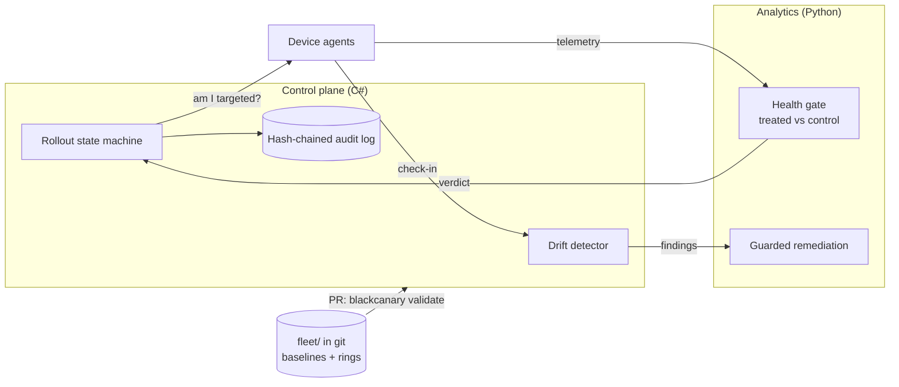

# Black Canary

[](https://github.com/ZakariDev27/black-canary/actions/workflows/ci.yml)

Fleet configuration as code, with rollouts that have to earn their way across the fleet.

Black Canary manages the desired state of a mixed macOS / Windows / Linux device fleet from a
git repository. A change is a reviewed pull request; it reaches devices ring by ring; each ring
has to prove itself healthy against a holdback group before the next one opens; and a ring that
goes bad rolls the change back without waiting for a human.

- **C# (.NET 8)** — the control plane: baseline model, drift detection, the rollout state machine,
  approvals, scoped API keys, and a hash-chained audit log.
- **Python 3.11+** — the analytics side: the statistical health gate that judges each ring from
  telemetry, fleet anomaly detection, and a guarded remediation executor.

The two halves share one wire contract, tested from both languages.

## Demo

```
python demo/run.py
```

One command starts the control plane and drives it end to end. Every step is asserted, so the
same script is the end-to-end test in CI. The middle of the run ([full transcript](docs/demo.txt)):

```
━━ 3. A sensitive change earns its way across the fleet ━━━━━━━━━━━━━━
  ▸ ada opens r-macos-core-3 for macos-core@3 — sensitive, so two approvals required
    ✗ ada tries to start it: Cannot start a rollout that is AwaitingApproval.
    ✗ ada (author-only key) tries to approve: This operation requires 'rollout:approve'.
    ✗ grace approves twice: 'grace' has already approved this rollout.
    ✓ approved by grace, linus
  ▸ started in ring 'canary' (5% of fleet)
    ✗ advance with no evidence: Ring 'canary' has no healthy verdict yet.
    ✓ gate: healthy (n=80)
    ✗ advance immediately: Ring 'canary' must soak for 00:00:03; only 00:00:00.0202633 has elapsed.
    ✓ advanced → ring 'broad'
    ✓ gate: healthy (n=80)
    ✓ advanced → ring 'fleet'
    ✓ gate: healthy (n=80)
    ✓ advanced completed

━━ 4. A bad change is stopped by its own canary ━━━━━━━━━━━━━━━━━━━━━━
  ▸ r-macos-browser-1 approved (standard change, one reviewer) and live in 'canary'
  ▸ this build crashes on ~1 in 4 machines and slows boot by a third
    ✗ gate: unhealthy (n=80)
        failure rate 26.2% exceeds the 10% ceiling
        failure rate 26.2% in treated vs 2.1% in control (p<0.0001)
        median boot time 31.1s vs 23.5s in control (+32%, p<0.0001)
    ✓ rolled back automatically — 95% of the fleet never saw it
    ✗ ada tries to push on anyway: Cannot advance a rollout that is RolledBack.
```

## How it fits together



| Path | What lives there |
| --- | --- |
| `src/BlackCanary.Core` | Domain: baselines, validation rules, drift scoring, ring assignment, rollout state machine, audit chain. No I/O beyond reading the fleet directory. |
| `src/BlackCanary.ControlPlane` | ASP.NET Core minimal API over the domain, with per-key scopes. |
| `src/BlackCanary.Cli` | `blackcanary validate / rings / drift` — the CI gate for config changes. |
| `analytics/` | `blackcanary` Python package: `stats`, `gate`, `anomaly`, `remediation`, HTTP client, CLI. Standard library only at runtime. |
| `fleet/` | The config-as-code itself: one JSON file per baseline, plus `rings.json`. |
| `contracts/` | Example documents that cross the language boundary; both test suites load them. |
| `demo/` | The guided demo and its fast-soak fleet. |

## Design decisions

**The rollout is a pure state machine.** `Rollout` is an immutable record; every transition
returns a new value or throws. Time is an argument, not something it reads. That is why rules
like "no advance before the ring has soaked" and "a verdict older than the ring cannot vouch for
it" are each a three-line unit test with no clock, sleep or mock.

**Ring membership is computed, not stored.** A device's ring is `SHA-256(change id, device id)`
mapped to a bucket. Any component can answer "is this device targeted yet?" without shared state,
widening a ring can never un-target a device, and salting by change id means the same machines
are not the canaries for every change.

**The gate compares against a concurrent control, not history.** Treated devices are tested
against a holdback over the same window (one-sided two-proportion test for failures,
Mann-Whitney for boot time), so an unrelated outage or OS update does not get blamed on the
rollout. It needs both statistical significance *and* a minimum effect size, and it counts
devices rather than check-ins so one crash-looping laptop is one data point.

**"Inconclusive" is a real answer.** Below a minimum cohort size the gate refuses to decide,
and the control plane will not advance on anything but `healthy`.

**Whatever proposes a fix is untrusted.** The remediation planner is a rule table today and
could be a language model tomorrow; either way its proposals go through a guard that knows only
an allow-list of tools with exact argument sets, the caller's scopes, and which tools are
sensitive. Sensitive steps need a named human. Decisions are re-reviewed at execution time, and
a failed plan is unwound in reverse.

**Sensitivity comes from the config, not the requester.** A baseline containing a setting marked
`sensitive` needs two approvers; the API derives that from the baseline, so a caller cannot
downgrade their own change. Authors can never approve their own rollout.

**The audit log is tamper-evident.** Each entry hashes the previous one over length-prefixed
fields; `GET /v1/audit/verify` reports the first entry at which history was edited or removed.

More detail in [docs/architecture.md](docs/architecture.md).

## Running it

Requires the .NET 8 SDK and Python 3.11+.

```bash
make build test        # C# build + xunit, then pytest
make lint              # ruff + mypy --strict
make validate          # lint the fleet configuration
make demo              # the guided run above
```

Run the control plane on its own and talk to it:

```bash
dotnet run --project src/BlackCanary.ControlPlane --launch-profile http

curl -X PUT localhost:5080/v1/devices/mac-001 \
  -H 'X-Api-Key: dev-agent' -H 'Content-Type: application/json' \
  -d '{"platform":"macOS","tier":"restricted","osVersion":"15.1","observedSettings":{"firewall.enabled":"false"}}'
```

The `dev-*` keys in `appsettings.Development.json` are placeholders for local use; outside
Development the service refuses to start without keys supplied through configuration.

Judge a ring from a telemetry file and submit the verdict:

```bash
pip install -e analytics
BLACKCANARY_API_KEY=dev-analytics blackcanary-analytics gate telemetry.jsonl \
  --rollout r-macos-core-3 --ring canary --post http://localhost:5080
```

The exit code follows the verdict (0 healthy, 1 unhealthy, 3 inconclusive, 2 error).

### API

| Method | Path | Scope |
| --- | --- | --- |
| `PUT` | `/v1/devices/{id}` | `device:checkin` |
| `GET` | `/v1/devices/{id}/drift`, `/v1/fleet/compliance` | `fleet:read` |
| `POST` | `/v1/rollouts` · `/{id}/start` · `/{id}/advance` · `/{id}/rollback` | `rollout:write` |
| `POST` | `/v1/rollouts/{id}/approvals` | `rollout:approve` |
| `POST` | `/v1/rollouts/{id}/verdicts` | `verdict:write` |
| `GET` | `/v1/rollouts`, `/v1/rollouts/{id}`, `/{id}/targets/{deviceId}` | `fleet:read` |
| `GET` | `/v1/audit`, `/v1/audit/verify` | `audit:read` |

## What this is not (yet)

This is a reference implementation of the control logic, not a product.

- State is in memory. `IRolloutStore` is the seam for a database; the compare-and-swap contract
  is already what a row-version column would give.
- There is no device agent. Check-ins and telemetry in the demo are synthetic.
- Remediation tools are interfaces; nothing here talks to an MDM.
- Drift is scored against the newest baseline in git for every device, regardless of which ring
  the device is in. Making drift ring-aware is the obvious next step.
- API keys with scopes stand in for real workload identity.

## License

MIT
